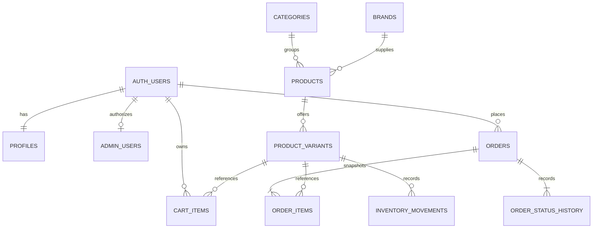

# Kế hoạch backend Supabase — Chanh&Man

Ngày lập: **01/10/2026** (Asia/Saigon). Cập nhật triển khai: **17/10/2026**. Trạng thái: **đã đủ 13/13 bảng ứng dụng, database/RPC hồ sơ, giỏ tài khoản và đơn hàng/kho BE-4 trên Supabase dev; chưa tích hợp FE**.

Đã triển khai trên project dev `manhngynne` (`dnnsfxgtngvkrvvzjovp`): bốn bảng catalog; `public.profiles`, `private.admin_users` ở BE-2; `public.cart_items`, `private.cart_merge_requests` ở BE-3; `public.orders`, `public.order_items`, `public.order_status_history`, `public.inventory_movements`, `private.shop_settings` ở BE-4. Tổng cộng **13/13 bảng ứng dụng** theo kế hoạch. Đã xóa hai bảng ngoài Plan theo yêu cầu trực tiếp của người dùng: `public.tasks` (1 dòng) và `public.products_legacy` (3 dòng); `auth.users` cùng các bảng hệ thống Supabase vẫn do nền tảng quản lý.

BE-4 đã có database/RPC báo giá, tạo đơn COD nguyên tử, retry theo request ID, snapshot, trừ/hoàn kho, lịch sử trạng thái, điều chỉnh kho admin và quyền đọc đơn. Phí giao hàng khởi tạo 30.000 VND; hợp đồng địa chỉ dùng `recipientName`, `phone`, `addressLine`, `province`, `ward?`, `note?`. Migration, hợp đồng RPC và kiểm tra thực tế nằm trong [supabase/README.md](./supabase/README.md) và [PROGRESS.md](./PROGRESS.md). BE-1 còn query/filter/count và nối service FE; BE-2 còn Auth/hồ sơ/session, callback/reset và email thật; BE-3 còn chọn giỏ tài khoản/merge khi đăng nhập/cleanup khi đăng xuất. BE-4 mới hoàn tất phần database/RPC: checkout và đơn của tôi trên FE vẫn dùng mock, chưa gọi backend thật. Chưa cấp admin đầu tiên. Quyền ghi catalog, giao diện quản trị và Storage tiếp tục theo BE-5. Phần hiện trạng ở mục 1 là ảnh chụp khi lập kế hoạch; tiến trình FE mới nhất xem PROGRESS.md.

Nguồn yêu cầu: [FE_PLAN.md](./FE_PLAN.md), [PROGRESS.md](./PROGRESS.md), [AGENTS.md](./AGENTS.md), các service và dữ liệu mock hiện tại. Theo yêu cầu mới, BE được xây **song song với FE**, nghiệm thu từng luồng thay vì chờ hoàn tất toàn bộ FE. Các quyết định dưới đây là phương án triển khai đề xuất; không phải mô tả database đang tồn tại.

## 1. Hiện trạng và phạm vi

| Phần | Đã có trong FE | Việc BE cần đáp ứng |
|---|---|---|
| Catalog | Home, danh mục, chi tiết, xem nhanh; lọc/tìm kiếm/sort/Xem thêm | Catalog chỉ đọc từ DB, giữ hình dạng dữ liệu service |
| Phiên bản | ID chuỗi, label, giá, tồn kho; album ở cấp sản phẩm | Giá/tồn kho theo phiên bản, SKU và ảnh riêng khi có |
| Giỏ | localStorage, Drawer và /cart; gộp theo variantId | Đọc lại giá/tồn kho thật; sau đó giỏ theo tài khoản và hợp nhất giỏ khách |
| Tài khoản | /login, /register, /account; phiên và hồ sơ giả lập trong tab | Auth thật, xác minh email, hồ sơ riêng, reset mật khẩu |
| Checkout/đơn | Chưa có; nút tiếp tục đặt hàng disabled | Báo giá, COD, tạo đơn nguyên tử, lịch sử và chi tiết đơn |
| Admin | Chưa có | Quyền quản trị, CRUD catalog, điều chỉnh tồn kho và xử lý đơn |
| Nhận xét | State dùng thử tại chi tiết, mất khi reload | Giữ phạm vi demo; chưa tạo bảng reviews |

`package.json` hiện chưa có SDK Supabase. `src/services/productService.js` đọc `services/mock/catalog.js`; `cartService.js` gọi `findVariant()` đồng bộ. `authService.js` dùng fixture và sessionStorage. Chưa kiểm kê project Supabase từ xa trong đợt lập kế hoạch này; thư mục thử kết nối cạnh dự án không được xem là backend chính hay nguồn schema.

Bản đầu: một cửa hàng, ba nhóm laptop/điện thoại/linh kiện, tiếng Việt, VND, đăng nhập để đặt COD, một địa chỉ cho mỗi đơn. Chưa làm thanh toán online, voucher, yêu thích, đánh giá lưu trữ, nhiều kho, giữ hàng theo thời gian hay tích hợp đơn vị vận chuyển.

## 2. Kiến trúc và quy ước

```text
Page/component → hook khi cần → service → Supabase Auth / Data API / Storage
                                         → RPC cho giao dịch đặt hàng và admin
```

- Giữ React/Vite/JavaScript và cấu trúc hiện có. Một client ở `src/services/supabase.js`; không thêm server riêng hoặc ORM cho CRUD đang được Supabase đáp ứng.
- Browser chỉ có URL và publishable key: dự kiến `VITE_SUPABASE_URL`, `VITE_SUPABASE_PUBLISHABLE_KEY`. Secret/service_role tuyệt đối không nằm trong biến VITE, source, log hoặc tài liệu.
- DB dùng `snake_case`; service ánh xạ về `camelCase`. Lỗi throw `{ code, message, fieldErrors? }`, không đưa cấu trúc SDK ra component.
- Product/variant/category/brand dùng PK `text` ổn định để giữ URL và giỏ cũ, ví dụ `air-13`, `air-13-256`, `laptop`, `phone`, `pc`. ID không sửa sau khi tạo. Đơn dùng UUID; người dùng dùng UUID của `auth.users`.
- Giá dùng `numeric(15,0)`, số lượng dùng integer; check không âm và giới hạn đầu vào để giá/tổng trả về vẫn là số nguyên an toàn trong JavaScript. Không dùng float để tính tiền. Currency chỉ `VND`.
- Thời gian dùng `timestamptz`, trao đổi ISO, hiển thị Asia/Saigon. Các bảng thay đổi được có `created_at`, `updated_at`; trigger DB cập nhật `updated_at`.
- Trạng thái dùng text + CHECK, tránh tạo enum riêng khi luồng còn đang hoàn thiện.
- Bảng ứng dụng trong `public` bật RLS ngay khi tạo; schema `private` không expose qua Data API, chứa quyền admin và hàm đặc quyền. GRANT và policy được thiết kế cùng migration.
- Migration là nguồn schema có thể dựng lại; seed là dữ liệu minh họa riêng. Không đồng bộ schema bằng sửa tay dashboard mà bỏ qua lịch sử.

## 3. Mô hình quan hệ



Không dựng mọi bảng ngay: catalog ở đợt 1, hồ sơ/quyền ở đợt 2, giỏ ở đợt 3, đơn và lịch sử kho ở đợt 4. `AUTH_USERS` là `auth.users` do Supabase quản lý, không tạo bảng users/mật khẩu thay thế.

### 3.1. Catalog

| Bảng | Trường chính và ràng buộc |
|---|---|
| `categories` | `id text PK`, `slug text UNIQUE NOT NULL`, `name text NOT NULL`, `caption`, `image_url`, `icon`, `sort_order integer DEFAULT 0`, `active boolean DEFAULT true` |
| `brands` | `id text PK`, `slug text UNIQUE NOT NULL`, `name text UNIQUE NOT NULL`, `active boolean DEFAULT true` |
| `products` | `id text PK`, `slug text UNIQUE NOT NULL`, `category_id text FK`, `brand_id text FK`, `name`, `description`, `badge`, `image_url`, `images jsonb DEFAULT []`, `specs jsonb DEFAULT []`, `specifications jsonb DEFAULT []`, `needs text[] DEFAULT {}`, `colors text[] DEFAULT {}`, `promotion boolean DEFAULT false`, `status text`, `sort_order integer DEFAULT 0` |
| `product_variants` | `id text PK`, `product_id text FK NOT NULL`, `sku text UNIQUE NOT NULL`, `label text NOT NULL`, `options jsonb DEFAULT {}`, `price numeric(15,0) NOT NULL CHECK > 0`, `compare_at_price numeric(15,0) NULL CHECK >= price`, `stock integer NOT NULL DEFAULT 0 CHECK >= 0`, `image_url NULL`, `active boolean DEFAULT true`, `sort_order integer DEFAULT 0` |

`category_id`, `brand_id`, name và ảnh chính là bắt buộc trước khi publish. Product status: `draft`, `active`, `archived`; bản draft có thể chưa có phiên bản, bản active phải có ít nhất một variant active. Kiểm tra điều kiện này trong thao tác publish/save nguyên tử, kể cả khi ẩn variant cuối. Hết hàng vẫn được hiển thị nếu active.

- `specs`: mảng chuỗi ngắn cho card, giữ tương thích FE; `specifications`: mảng `{key,label,value,unit?}` khi có thông số chi tiết. Kiểm tra kiểu JSON và giới hạn độ dài/số phần tử ở thao tác ghi.
- `options`: cấu hình linh hoạt theo danh mục, ví dụ RAM/storage/color; không suy ra dữ liệu bằng parse label khi chạy thật. Seed khai báo rõ option và SKU cho từng variant.
- `needs` dùng các mã `study/work/game/creative/upgrade`; `colors` giữ danh sách màu cấp product đúng bộ lọc hiện tại. Cập nhật chúng cùng cấu hình khi admin sửa; chưa tạo bảng thuộc tính/EAV hoặc danh mục nhu cầu riêng.
- `promotion` là nhãn lọc hiện có, không phải voucher hay quy tắc tính tiền. `compare_at_price` tùy chọn để thể hiện giá tham chiếu; không tự suy ra mọi nhãn khuyến mại từ trường này.
- Ban đầu `images` lưu mảng URL có thứ tự; chưa cần bảng media. Ảnh variant fallback về ảnh product. Nội dung Home/hero/chính sách và danh sách nhu cầu cố định tiếp tục ở FE; chưa làm CMS.
- FK danh mục/hãng/variant dùng RESTRICT khi đã được tham chiếu. Ẩn/archived thay xóa product và variant đã có trong đơn. Admin xử lý danh mục/hãng đang dùng bằng đổi liên kết hoặc ẩn, không cascade xóa catalog.

### 3.2. Hồ sơ và quyền

| Bảng | Trường chính và ràng buộc |
|---|---|
| `profiles` | `id uuid PK FK auth.users(id) ON DELETE CASCADE`, `display_name text NOT NULL` (trim 2–80 ký tự), `phone text NULL` (8–15 chữ số, cho phép `+` đầu), timestamps |
| `private.admin_users` | `user_id uuid PK FK auth.users(id) ON DELETE CASCADE`, `created_at`; có dòng nghĩa là admin |

Email, mật khẩu và trạng thái xác minh thuộc Auth; không sao chép mật khẩu hoặc email vào hồ sơ. Service ghép email từ user Auth và role từ phép kiểm tra quyền backend. Đăng ký mặc định customer; không nhận role từ form, user_metadata hoặc localStorage.

Trigger tạo profile khi Auth tạo user: chỉ lấy tên từ metadata làm dữ liệu hiển thị, validate/fallback tên hợp lệ để không chặn đăng ký. Hàm trigger đặc quyền đặt ở private, search_path cố định, không cấp EXECUTE cho client. Backfill profile cho tài khoản có sẵn trước khi nối FE.

Admin đầu tiên được cấp bằng thao tác quản trị đáng tin cậy trên môi trường dev; không tạo endpoint tự nâng quyền. Helper `private.is_admin()` kiểm tra `auth.uid()` với bảng quyền, trả false khi không có phiên, tránh vòng lặp RLS. Đây là nguồn quyền live; FE guard chỉ phục vụ điều hướng. Khách thường không được đọc danh sách admin.

Không triển khai xóa tài khoản ở bản đầu. Trước khi có chức năng đó phải chốt lưu giữ/anonymize đơn; không cascade xóa lịch sử mua.

### 3.3. Giỏ tài khoản

`cart_items`: `user_id uuid FK auth.users ON DELETE CASCADE`, `variant_id text FK product_variants ON DELETE RESTRICT`, `quantity integer CHECK > 0`, timestamps; PK `(user_id, variant_id)`.

Không lưu tên/giá/tổng làm nguồn tiền trong giỏ. Giỏ không giữ hàng. Dòng vượt tồn kho hoặc variant bị ẩn được trả về kèm notice/không khả dụng để khách xem lại; điều chỉnh theo hành vi FE đã thống nhất, không coi đó là đã đặt hàng.

Giỏ khách vẫn localStorage. Khi đăng nhập: hợp nhất theo variantId, cộng lượng và đối chiếu catalog; chỉ xóa giỏ khách sau khi server commit. Để retry không cộng hai lần, bổ sung `private.cart_merge_requests(user_id uuid, request_id uuid, payload jsonb, created_at)` với PK `(user_id,request_id)` khi triển khai merge; lưu dấu merge và cập nhật giỏ trong cùng transaction. Cùng ID nhưng payload khác bị từ chối. Khi logout bỏ state giỏ tài khoản, không chép dữ liệu riêng sang giỏ khách.

### 3.4. Đơn hàng và kho

| Bảng | Trường chính và ràng buộc |
|---|---|
| `orders` | `id uuid PK`, `code text UNIQUE` do DB sinh từ sequence, `user_id uuid NOT NULL FK auth.users ON DELETE RESTRICT`, `request_id uuid NOT NULL`, `request_payload jsonb NOT NULL`, `shipping_address jsonb NOT NULL`, `subtotal`, `shipping_fee`, `total` đều numeric(15,0), `currency text DEFAULT VND`, `payment_method text DEFAULT cod`, `payment_status text DEFAULT unpaid`, `status text DEFAULT pending`, timestamps; UNIQUE `(user_id,request_id)` |
| `order_items` | `id uuid PK`, `order_id uuid FK orders ON DELETE RESTRICT`, `variant_id text FK variants ON DELETE RESTRICT`, `sku`, `product_name`, `variant_label`, `image_url`, `unit_price numeric(15,0) CHECK > 0`, `quantity integer CHECK > 0`; UNIQUE `(order_id,variant_id)`; line total tính từ unit_price × quantity |
| `order_status_history` | `id uuid PK`, `order_id uuid FK orders ON DELETE RESTRICT`, `from_status NULL`, `to_status`, `actor_id uuid FK auth.users ON DELETE SET NULL`, `note NULL`, `created_at`; ghi pending ban đầu và mọi chuyển trạng thái |
| `inventory_movements` | `id uuid PK`, `variant_id text FK`, `order_id uuid NULL FK`, `actor_id uuid NULL FK auth.users ON DELETE SET NULL`, `quantity_delta integer CHECK != 0`, `reason text` (`initial/order/cancel/adjustment`), `note NULL`, `created_at` |
| `private.shop_settings` | Một dòng cấu hình `id=1`, `shipping_fee numeric(15,0) CHECK >= 0`, `updated_at`; chưa cần hệ thống cấu hình key/value |

Địa chỉ snapshot: `{recipientName, phone, addressLine, ward?, province, note?}`; bắt buộc tên/điện thoại/địa chỉ/tỉnh thành và validate độ dài. Chưa tạo sổ địa chỉ hoặc danh mục hành chính. Cấu trúc form được chốt cùng FE checkout.

`subtotal >= 0`, `shipping_fee >= 0`, `total = subtotal + shipping_fee`; kiểm tra tổng order_items trong transaction, không dùng CHECK truy vấn chéo bảng. Snapshot tên/SKU/giá/địa chỉ không sửa theo catalog/hồ sơ mới. Request payload chuẩn hóa dùng đối chiếu retry, không ghi mật khẩu/token và không expose cột này trong API đọc đơn.

Stock là số còn có thể bán: trừ ngay khi tạo đơn pending, không trừ lại lúc confirmed/delivered. `inventory_movements` chỉ là lịch sử thay đổi; nguồn đọc nhanh là variant.stock. Cả hai luôn được cập nhật trong một transaction. Unique partial `(order_id,variant_id,reason)` cho reason order/cancel giúp ngăn ghi trừ/hoàn hai lần. Khi đưa ledger vào, ghi initial cho tồn kho hiện có để có điểm đối chiếu.

## 4. Quyền dữ liệu và RLS

RLS giới hạn dòng; GRANT giới hạn bảng/cột/thao tác. Phải có cả hai. Mọi bảng public bật RLS, kể cả bảng lịch sử chưa cấp quyền client. Theo [hướng dẫn RLS](https://supabase.com/docs/guides/database/postgres/row-level-security), UPDATE cần policy SELECT; quyền sở hữu dùng auth.uid(), UPDATE có USING/WITH CHECK.

| Dữ liệu | Khách chưa đăng nhập | Customer | Admin |
|---|---|---|---|
| Categories/brands | SELECT active | Như khách | Xem tất cả; ghi qua service quản trị |
| Products/variants | SELECT đang bán và parent hợp lệ | Như khách | Xem draft/archived; ghi catalog qua thao tác được kiểm tra |
| Profiles | Không | SELECT/UPDATE của mình | Hồ sơ của mình; thông tin giao hàng khách lấy từ đơn |
| Cart items | Không | SELECT/INSERT/UPDATE/DELETE của mình | Giỏ của mình |
| Orders/items/history | Không | SELECT đơn của mình và dòng thuộc đơn đó | SELECT toàn bộ đơn; chuyển trạng thái qua RPC |
| Inventory movements | Không | Không | SELECT; ghi chỉ qua giao dịch kho |
| Quyền admin/cấu hình/merge receipt | Không | Không đọc bảng trực tiếp | Thông qua helper/RPC được phép; cấp quyền admin ngoài client |

- RLS variant kiểm tra product active, danh mục/hãng active; product cũng kiểm tra parent. Không để API trực tiếp đọc phiên bản của product đã ẩn. Admin được đọc catalog ẩn để chỉnh sửa.
- Profile chỉ GRANT UPDATE(display_name, phone), không quyền đổi id/timestamps. Cart USING/WITH CHECK cùng user_id = auth.uid(); các trường riêng trong đơn chỉ cấp SELECT cần thiết.
- Khách/customer/admin đều không có DML trực tiếp trên orders, order_items, history và ledger. Việc gửi PATCH sửa total, chủ đơn, trạng thái hay stock phải thất bại khi thử bằng API.
- Stock chỉ đổi qua RPC kho/đơn; thao tác save catalog không được lén sửa stock. Admin insert variant khởi tạo stock=0 rồi điều chỉnh qua giao dịch kho khi ledger đã có.
- Nếu dùng view cho catalog/đơn: `security_invoker=true` và rà cột trả về. Mặc định ưu tiên query/RPC rõ ràng, không tạo view đặc quyền vô tình bỏ qua RLS.
- RPC đọc dùng SECURITY INVOKER. Giao dịch đặc quyền có hàm xử lý trong private với search_path rỗng/tên bảng đầy đủ, auth.uid() và kiểm tra admin/chủ sở hữu trong body; public wrapper SECURITY INVOKER chỉ mở điểm gọi cần thiết. REVOKE EXECUTE từ PUBLIC/anon, GRANT đúng authenticated và USAGE private tối thiểu để wrapper gọi được. Private không nằm trong exposed schemas; không cấp quyền bảng private cho client. Rà quyền cả wrapper lẫn hàm nội bộ, không coi RLS tự bảo vệ hàm đặc quyền.

## 5. Query catalog và hợp đồng service

| Service | Thiết kế BE / tương thích FE |
|---|---|
| `getHomeContent` | Categories từ DB; needs cố định ở FE; giữ Promise và signal |
| `listProducts` | RPC đọc catalog/filter/sort/count thống nhất; trả `{items,total,page}` sau ánh xạ, không trả raw SDK |
| `getProduct(id)` | Product + variants active; NOT_FOUND nếu không có/quyền không cho thấy |
| `getCategoryFilters` | Hãng/màu từ toàn bộ catalog hợp lệ của danh mục, không chỉ từ trang hiện tại |
| `findVariant` hiện đồng bộ | Thay các caller giỏ bằng truy vấn theo lô variantIds bất đồng bộ; không giữ mock để tra tồn kho sau khi catalog đã thật |
| Auth/profile | Giữ kiểu user `{id,displayName,email,phone,role}`; `getSession()` trả user hoặc null theo hợp đồng hiện có |
| Cart | Giữ `{items,count,total,notices?}`; items có productId/name/image/label/price/stock từ catalog thật |
| Quote/create/list/detail order | Service mới chốt cùng checkout FE; danh sách đơn có items,total,page, detail chứa snapshots |
| Admin/media | Tạo/sửa/ẩn catalog, điều chỉnh stock, chuyển trạng thái, upload ảnh qua service tương ứng |

Giá khởi điểm = min(price) của variant active, kể cả variant hết hàng như mock. Lọc giá dùng các khoảng `[0,20 triệu)`, `[20,30 triệu)`, `[30,40 triệu)`, `[40 triệu,+∞)`; tồn kho là có ít nhất một variant active stock > 0. Hai bộ lọc này hiện độc lập; không tự đổi thành cùng một variant phải đáp ứng cả hai.

Query `q` chuẩn hóa lowercase/bỏ dấu/đ→d, tách từ và tất cả từ phải xuất hiện trong tên/hãng/specs/tên danh mục giống mock. Dùng helper SQL normalize ở DB, xác minh extension unaccent nếu chọn dùng; không chỉ normalize input ở FE. Escape `%/_` nếu dùng LIKE để chúng không thành wildcard ngoài ý muốn. Chưa thêm search engine; cân nhắc trigram khi số liệu truy vấn chứng minh cần.

DB lọc/sort trước limit và trả total trước phân trang. Sort có khóa phụ id để Xem thêm ổn định; featured dùng sort_order, name dùng quy tắc tiếng Việt được kiểm tra với fixture, giá dùng min active price. Danh mục hiện query page=1, limit=20×mức Xem thêm; giữ hành vi này, không nhầm mức hiển thị URL với offset page của service. Home vẫn dùng limit riêng.

Giữ `{image,images,specs,category,brand,needs,colors,promotion,variants}` tại service mapping; product.category là mã hiện tại, brand là tên hiển thị. Không bắt UI đổi toàn bộ theo schema SQL. Đợt tích hợp catalog phải thay cả cartService vì cart đang đọc mock đồng bộ.

## 6. Giao dịch checkout COD

### Báo giá

`quoteOrder({items:[{variantId,quantity}],shippingAddress,paymentMethod:'cod'})`: validate đầu vào; lấy giá/tồn kho hiện tại và phí từ shop_settings; trả dòng snapshot tạm, subtotal/shippingFee/total và lỗi từng dòng. Không giữ hàng, không ghi order.

Kết quả có fingerprint báo giá (giá mỗi dòng + phí + danh sách/số lượng) để FE gửi lại khi tạo đơn. Fingerprint không phải quyền quyết định giá: server luôn tính lại. Có thay đổi thì PRICE_CHANGED trả báo giá mới, FE yêu cầu khách xác nhận lại. Không cần bảng quote hoặc cron hết hạn cho COD bản đầu.

### Tạo đơn nguyên tử

`createOrder` nhận items, địa chỉ, COD, requestId UUID và báo giá đã xác nhận; không nhận userId/status/tổng tiền như dữ liệu đáng tin cậy.

1. Yêu cầu Auth hợp lệ, tài khoản đã xác minh; validate kiểu/số lượng/độ dài, giới hạn đề xuất 100 dòng và 1–999 sản phẩm mỗi dòng; gộp trùng variantId rồi kiểm tra lại giới hạn.
2. Chuẩn hóa payload; serialize cùng `(user,requestId)` bằng transaction advisory lock hoặc cơ chế tương đương có kiểm tra concurrency. Nếu đã có order cùng ID/payload, trả đơn cũ ngay; payload khác trả REQUEST_CONFLICT. Unique DB vẫn là lớp bảo vệ cuối.
3. Khóa variant theo ID tăng dần bằng FOR UPDATE; khóa/đọc parent và cấu hình giá/phí theo thứ tự thống nhất với thao tác admin để không tạo đơn từ catalog vừa bị ẩn. Kiểm tra active, tồn kho, giá/phí so với báo giá đã xác nhận.
4. Tính lại tiền trong DB, tạo orders/order_items/history pending, trừ stock và ghi movement order. Bất kỳ lỗi nào rollback toàn bộ, không có đơn dở hoặc kho đã trừ.
5. Commit rồi trả order ID/code và tổng; FE chỉ xóa các dòng đã mua sau khi có kết quả xác nhận. Retry mất phản hồi dùng cùng requestId/payload, không tự sinh ID mới.

Giỏ có thể thay đổi ở tab khác: không xóa cả giỏ một cách mù quáng; chỉ trừ lượng đã mua khỏi các dòng tương ứng, hoặc kiểm tra phiên bản giỏ trước khi dọn. Dọn giỏ server nếu thực hiện trong RPC phải cùng transaction; FE không trừ lần nữa khi retry trả đơn cũ. Chốt một cách duy nhất trong đợt checkout.

### Trạng thái và hoàn kho

| Trạng thái hiện tại | Được chuyển tới | Kho / thanh toán |
|---|---|---|
| pending | confirmed, cancelled | Hủy hoàn đúng một lần |
| confirmed | shipping, cancelled | Hủy hoàn đúng một lần |
| shipping | delivered | Không hủy ở bản đầu |
| delivered | Không | COD chuyển paid cùng xác nhận giao thành công |
| cancelled | Không | Giữ unpaid; không hoàn lần nữa |

Bản đầu chỉ admin chuyển trạng thái; chưa có khách tự hủy. RPC khóa order trước, rồi variant theo ID như cùng quy ước của tạo đơn/kho; ghi history và cập nhật status/payment/stock/ledger trong một transaction. Gửi lại trạng thái hiện tại không tạo history hoặc hoàn kho lần nữa. Lưu người thao tác và lý do hủy; không cho chuyển ngược hoặc tự gửi paid từ FE.

Điều chỉnh tồn kho admin nhận targetStock hoặc delta cùng expectedStock/version, kiểm tra xung đột, khóa variant, cập nhật stock và movement adjustment. Khi số lượng đã bị giao dịch khác thay đổi, trả CONFLICT để admin tải lại, tránh ghi đè bằng số cũ.

## 7. Auth và Storage

- Auth email/password thật, bật xác minh email; cấu hình Site URL và allowlist callback cho localhost/môi trường triển khai. FE bổ sung route callback/reset theo flow đã chọn; next vẫn chỉ nhận URL cùng nguồn được phép.
- Thay fixture, demoPassword, verifyDemoEmail và thông báo mô phỏng trong đợt Auth; tài khoản demo không tự chuyển thành user thật. Dùng Auth session/refresh và onAuthStateChange, cleanup subscription, không giữ timer phiên 1 giờ giả làm nguồn xác thực.
- Đăng ký/đăng nhập/reset có loading/lỗi; không cam kết luôn báo EMAIL_EXISTS vì Auth có thể che thông tin tồn tại tài khoản. Ánh xạ an toàn theo phản hồi thật, reset báo thông điệp chung.
- Trước mở bán kiểm tra gửi email, redirect, liên kết hết hạn và cấu hình SMTP phù hợp; không coi nút mô phỏng xác minh là hoàn thành Auth.
- Bucket `product-images` public chỉ chứa ảnh catalog công khai. URL public không làm upload tự do: INSERT/UPDATE/DELETE storage.objects chỉ cho admin và đúng bucket/path. Không đưa tài liệu khách hay thông tin giao hàng vào bucket này.
- Path dự kiến `products/{productId}/{uuid}.{ext}`; giới hạn ban đầu JPEG/PNG/WebP, tối đa 5MB, kiểm tra file ở FE và bucket. Dùng tên mới khi thay ảnh; ghi URL mới sau upload thành công, xóa ảnh cũ khi không còn tham chiếu. Thất bại không xóa ảnh đang dùng.
- Đợt catalog đầu có thể giữ URL `/images/...` và ảnh trong public hiện tại. Storage triển khai cùng admin upload, không bắt chuyển hết ảnh ngay. Theo [Storage access control](https://supabase.com/docs/guides/storage/security/access-control), nếu dùng upsert phải có đủ SELECT/INSERT/UPDATE tương ứng.

## 8. Chỉ mục, seed và migration

Chỉ mục phục vụ luồng thật: products(category_id,status,sort_order,id), products(brand_id), variants(product_id,active), cart_items(variant_id), orders(user_id,created_at DESC,id), orders(status,created_at DESC,id), order_items(order_id) qua unique, order_items(variant_id), history(order_id,created_at), movements(variant_id,created_at), movements(order_id). Rà FK actor_id và các FK chưa được bao phủ. PK/UNIQUE đã có index thì không tạo bản trùng.

Với RLS theo auth.uid, kiểm tra index user_id và kế hoạch truy vấn thực tế. Chưa thêm GIN mọi cột JSON/array, materialized view, partition hoặc cache; đo EXPLAIN trên dữ liệu đủ lớn trước khi tối ưu. Kho nhỏ ưu tiên query dễ hiểu.

Seed catalog từ **toàn bộ mock hiện tại**, giữ ID/ảnh/thứ tự/giá/tồn kho/màu/nhu cầu, gồm các sản phẩm được bổ sung để thử Xem thêm; không dựa vào ghi chép cũ chỉ có sáu sản phẩm. Bổ sung slug/SKU/options một cách xác định. Seed upsert theo ID để chạy lại không nhân bản; không reset tồn kho thật khi reseed production. Không đưa tài khoản/mật khẩu demo vào migration.

Thứ tự migration theo nhóm:

1. Catalog tables, constraints, RLS, grants, hàm đọc và helper tìm kiếm.
2. Profiles, trigger/backfill, private admin_users, helper quyền và policies.
3. Cart_items, merge receipt/RPC và policies.
4. Orders/items/settings/history/movements; RPC quote/create/status/stock và quyền.
5. Quyền ghi catalog admin, Storage bucket/policies; bổ sung đúng lúc có FE quản trị.

Khi triển khai: xác minh project/ref và môi trường dev, kiểm kê schema/Auth/buckets hiện hữu trước; không mặc định project rỗng. Kiểm tra CLI version/--help, tạo migration qua CLI, phát triển ở local/dev; rà advisors và diff trước khi áp dụng. Dựng lại DB sạch từ migrations+seed, không chỉ kiểm tra database đã sửa tay. Production dùng migration đã kiểm thử, bảo vệ dữ liệu và có bản sao lưu/đường khôi phục trước thay đổi rủi ro. Không rollback bằng drop bảng dữ liệu bán hàng.

## 9. Lộ trình BE song song FE

| Đợt | BE thực hiện | FE phối hợp | Điều kiện nghiệm thu |
|---|---|---|---|
| BE-0: nền tảng | Kiểm kê project dev, môi trường/keys, migration workflow, hợp đồng mapping | Giữ mock khi chưa nối từng phần | Chọn đúng project, không lộ secret, có thể dựng DB dev |
| BE-1: catalog thật | Tables catalog, seed, RLS đọc, query/filter/count | Thay productService; giỏ khách đọc variant thật theo lô | Home/Category/Product/giỏ chạy dữ liệu thật; lọc/sort/Xem thêm tương thích; ẩn không lộ qua API |
| BE-2: Auth/hồ sơ | Auth, profiles/quyền admin, RLS | Thay authService, xác minh/callback/reset, hồ sơ | Hai user không đọc/sửa hồ sơ nhau; login/logout/reset thật; giỏ khách giữ nguyên |
| BE-3: giỏ tài khoản | cart_items, merge RPC idempotent | useCart chọn guest/user, hợp nhất và cleanup logout | Giỏ riêng, retry không cộng hai lần, giữ giỏ nếu server lỗi |
| BE-4: checkout/đơn | Quote/create COD, snapshots, khóa kho, requestId, ledger/history | Build checkout, guard, kết quả và đơn của tôi cùng hợp đồng thật | Tạo đơn và trừ kho nguyên tử; retry đúng; hai khách tranh hàng cuối chỉ một đơn thành công |
| BE-5: admin/ảnh | Quyền ghi catalog, publish/ẩn, stock/status RPC, Storage | Build admin theo từng chức năng | Customer gọi API admin bị từ chối; admin cập nhật phản ánh cửa hàng; hủy hoàn một lần |
| BE-6: nghiệm thu | Rà RLS/grants/advisors, restore, quyền và concurrency | Luồng xuyên suốt/responsive/loading/error | Checklist mục 10 đạt; ghi rõ giới hạn còn lại trước mở bán |

Đợt tiếp theo nên làm **BE-0 → BE-1** vì catalog FE đã tương đối ổn. Checkout và admin tiếp tục xây FE song song; chưa cần dựng lại hệ mock ghi catalog/đơn nếu đã có thể dùng môi trường Supabase dev. Mock có ích cho test service/UI thì giữ riêng, không fallback âm thầm sang mock khi Supabase lỗi.

## 10. Kiểm tra và tiêu chí hoàn thành

Lưu các kiểm tra có thể chạy lại trong đợt triển khai, dùng bộ Node test hiện có và một script SQL kiểm tra constraints/quyền phù hợp; không chỉ thử qua giao diện hay SQL editor quyền postgres. Với RLS, gọi API bằng publishable key và JWT khách/customer A/customer B/admin.

- [ ] DB dev dựng lại được từ migrations và seed; bảng expose đều RLS, grants/RPC EXECUTE đúng phạm vi; advisors được rà và lỗi liên quan được xử lý.
- [ ] Catalog: không dấu/đ, nhiều từ, ký tự wildcard, mọi bộ lọc/biên giá, sort ổn định, total/Xem thêm, sản phẩm ẩn và phiên bản hết hàng.
- [ ] Giỏ sau catalog thật không còn lấy giá/kho từ findVariant mock; tồn kho thay đổi, variant ẩn, lỗi mạng không làm mất dữ liệu khách.
- [ ] Auth thật: đăng ký/xác minh/reset/login/logout/hết phiên; hồ sơ riêng; giả role/userId/metadata không nâng quyền.
- [ ] Giỏ user: tách A/B, merge trùng/khác variant, retry/mất phản hồi, logout không lộ giỏ riêng.
- [ ] Order: input sai/âm/lẻ/quá giới hạn, sửa giá/phí/userId, báo giá đổi, thiếu kho; lỗi rollback không có order/items/stock dở.
- [ ] Hai yêu cầu cùng requestId đồng thời tạo đúng một đơn; payload khác bị từ chối; retry sau thành công trả đơn cũ dù kho đã đổi.
- [ ] Hai khách mua hàng cuối không làm stock âm; nhiều variant khóa nhất quán; admin chỉnh kho/ẩn/sửa giá đồng thời có kết quả rõ.
- [ ] Đơn A không đọc được bởi B qua ID trực tiếp/items/history; snapshot giữ nguyên sau sửa catalog/hồ sơ; client không PATCH total/status/stock.
- [ ] Chuyển trạng thái đúng; hủy/retry hủy hoàn đúng một lần; ledger khớp kho; delivered/paid cập nhật cùng transaction.
- [ ] Storage: khách/customer không upload/overwrite/delete, admin đúng bucket/path, file sai loại/quá lớn thất bại, upload lỗi giữ ảnh cũ.
- [ ] Lint/build và test service liên quan đạt; kiểm tra browser từ chọn hàng → login → checkout → đơn → admin, loading/error/retry và responsive theo FE_PLAN.
- [ ] Không còn credential demo trong luồng thật; seed/ảnh/giá minh họa được ghi rõ, không tuyên bố mở bán trước nghiệm thu giao dịch và chính sách.

## 11. Quyết định cần chốt khi triển khai

Không chặn lập kế hoạch; xác minh đúng lúc bước đó bắt đầu:

- BE-0: project Supabase dev nào dùng, có schema/dữ liệu hiện hữu không, cách chạy local/dev và môi trường deploy dự kiến.
- BE-2: domain/callback và cấu hình email; ai được cấp admin đầu tiên.
- BE-4: phí giao hàng ban đầu, field địa chỉ, giới hạn đơn và chính sách xác nhận/hủy COD; mặc định trong kế hoạch là phí cố định từ DB, chỉ admin hủy pending/confirmed.
- BE-5: nội dung/ảnh thật, thông số chi tiết và quy tắc publish; chính sách bán hàng chính thức cần hoàn thiện trước mở bán.

Không dùng ngày dự kiến hoặc phần trăm giả. Mỗi đợt hoàn tất cập nhật [PROGRESS.md](./PROGRESS.md) với migration/service liên quan, kiểm tra thực chạy và phần FE/BE còn thiếu.

## 12. Tài liệu kỹ thuật

- [React quickstart](https://supabase.com/docs/guides/getting-started/quickstarts/reactjs): client React và môi trường.
- [Securing your API](https://supabase.com/docs/guides/api/securing-your-api): quyền Data API và schema expose.
- [Row Level Security](https://supabase.com/docs/guides/database/postgres/row-level-security): policies, ownership, views và quyền thao tác.
- [Database functions](https://supabase.com/docs/guides/database/functions): RPC, security invoker/definer và EXECUTE grants.
- [Managing user data](https://supabase.com/docs/guides/auth/managing-user-data): profiles và trigger Auth.
- [Storage access control](https://supabase.com/docs/guides/storage/security/access-control): policies ảnh.
- [Database migrations](https://supabase.com/docs/guides/deployment/database-migrations): schema có thể tái dựng.
- [Supabase changelog](https://supabase.com/changelog): kiểm tra lại thay đổi liên quan trước mỗi đợt triển khai; đợt này đã rà trang changelog thay cho bản .md không truy cập được. Chưa kiểm tra version/config của project thực tế.
